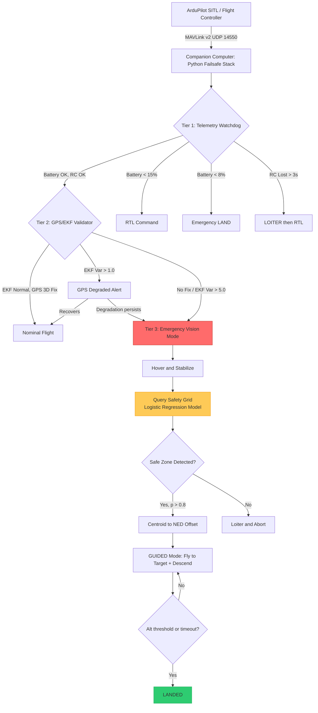
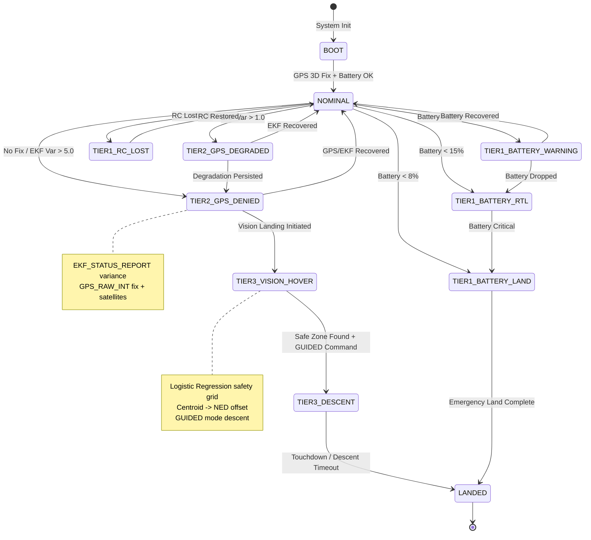
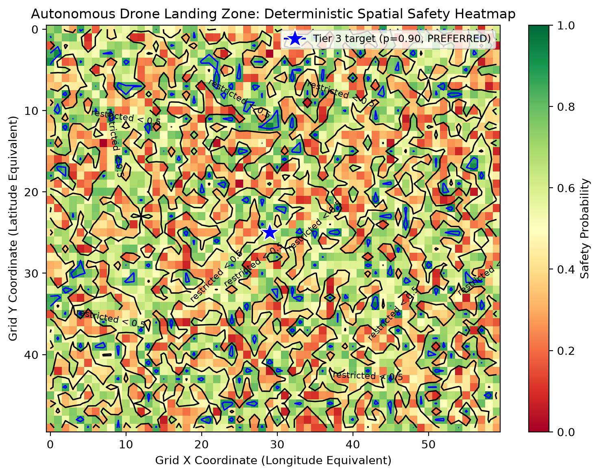

# 🛸 Tiered Autonomous Drone Failsafe Hierarchy

**A three-tier emergency landing system for autonomous drones. When GPS fails, the drone doesn't crash — it sees, decides, and lands safely.**

[](https://python.org)
[](https://ardupilot.org)
[](LICENSE)

---

## 🎯 The Problem

Autonomous drones rely on GPS for navigation and Return-to-Launch (RTL) failsafes. But GPS can be **jammed, spoofed, or denied** — in urban canyons, near military installations, or during adversarial attacks. When GPS fails, standard RTL becomes dangerous: the drone doesn't know where "home" is, and the EKF (Extended Kalman Filter) loses position confidence.

**Without a fallback, the drone crashes.**

## 🏗️ The Solution

A **three-tier failsafe hierarchy** that degrades gracefully:

| Tier | Trigger | Action |
|------|---------|--------|
| **Tier 1: Telemetry** | Battery < 15%, RC lost | RTL or Loiter via MAVLink |
| **Tier 2: Environmental** | GPS denied, EKF variance spike | Escalate to Tier 3 |
| **Tier 3: Vision Landing** | GPS unavailable | ML-based safe-zone selection → GUIDED descent |

When Tier 2 detects GPS denial, the system activates a **pre-trained terrain safety model** that identifies the safest reachable landing zone from a pre-computed probability grid, computes its centroid, converts it to local NED coordinates, and commands a GUIDED-mode descent to that location.

---

## 🧭 System Architecture



> Full design rationale, threshold justification, and the ML data-pipeline diagram live in [`docs/architecture.md`](docs/architecture.md).

## 🔁 Failsafe State Machine

The system is driven by a deterministic, enum-based state machine evaluated at 10 Hz. Every transition is written to a structured JSONL black box.



## 🧠 Tier 3: Vision Landing Engine

The vision landing engine scores a 60×50 terrain grid using a **Logistic Regression pipeline** trained on 3,000 tiles with 8 engineered features:

| Feature | Physical Meaning |
|---------|------------------|
| `slope_deg` | Terrain steepness — strongest single predictor of tipping risk |
| `roughness` | Surface irregularity / local elevation variance |
| `edge_density` | Visual clutter proxy (rocks, fences, structures) |
| `ndvi_mean` | Vegetation cover from red/NIR reflectance |
| `shadow_fraction` | Occlusion risk; hides obstacles from optical sensors |
| `brightness_std` | Surface homogeneity measure |
| `object_density` | Discrete obstacle density (collision risk) |
| `confidence_score` | Upstream perception reliability meta-feature |

**Model selection rationale:** Logistic Regression was chosen over a marginally higher-scoring SVM (ROC-AUC 0.761 vs 0.761) for **algorithmic transparency**. In safety-critical systems, explicit log-odds coefficients allow deterministic auditing of how the drone weighs physical hazards — a property black-box models cannot provide.

**Zone tiering:**
- 🟢 **Preferred** (p > 0.8): default landing targets
- 🟡 **Conditional** (0.5–0.8): fallback if no preferred zone is reachable
- 🔴 **Restricted** (< 0.5): never land; abort and loiter


*Deterministic spatial safety heatmap with the Tier 3 decision boundaries (0.5 / 0.8) and the selected landing target (★). Regenerate with `python tools/generate_heatmap.py`.*

---

## 🚀 Quick Start

### Prerequisites
- Ubuntu 22.04+ · Python 3.11+ · ~8 GB disk for ArduPilot SITL

### 1. Install ArduPilot SITL
```bash
git clone --recursive https://github.com/ArduPilot/ardupilot.git
cd ardupilot
Tools/environment_install/install-prereqs-ubuntu.sh -y
source ~/.bashrc
./waf configure --board sitl
./waf copter
```

### 2. Set up the Python environment
```bash
cd ~/tiered_drone_failsafe
python3 -m venv venv
source venv/bin/activate
pip install -r requirements.txt
```

### 3. Launch SITL (Terminal 1)
```bash
cd ~/ardupilot
./Tools/autotest/sim_vehicle.py -v ArduCopter --console --map
```

### 4. Run the failsafe stack (Terminal 2)
```bash
cd ~/tiered_drone_failsafe
source venv/bin/activate
python src/main.py
```

### 5. Test the full cascade (MAVProxy console)
```text
mode GUIDED
arm throttle
takeoff 20
param set SIM_GPS1_ENABLE 0     ← kills GPS → Tier 2 → Tier 3 vision landing
param set SIM_GPS1_ENABLE 1     ← restores GPS
```

---

## 🧪 Testing

### Unit tests (no SITL required)
```bash
python src/test_tier1.py
```

### SITL integration scenarios

| Scenario | Command | Expected Transition |
|----------|---------|---------------------|
| Battery RTL | `param set SIM_BATT_VOLTAGE 10.8` | `NOMINAL → TIER1_BATTERY_RTL` |
| Battery emergency | `param set SIM_BATT_VOLTAGE 10.0` | `NOMINAL → TIER1_BATTERY_LAND` |
| GPS denial | `param set SIM_GPS1_ENABLE 0` | `NOMINAL → TIER2_GPS_DENIED → TIER3_*` |
| GPS recovery | `param set SIM_GPS1_ENABLE 1` | `TIER2_* → NOMINAL` |

---

## 📦 Black Box Logger

Every session writes a structured JSONL flight record to `logs/`:

```json
{"event": "STATE_TRANSITION", "from_state": "NOMINAL", "to_state": "TIER2_GPS_DENIED", "reason": "Environment Critical: GPS=0, Sats=0", "rel_time_s": 15.4}
{"event": "COMMAND_SENT", "command": "SET_MODE", "params": {"mode": "GUIDED"}, "rel_time_s": 15.6}
```

Post-flight analysis with pandas:
```python
import pandas as pd
df = pd.read_json("logs/flight_20260928_143022.jsonl", lines=True)
```

---

## ⚠️ Known Limitations & Honest Engineering Notes

1. **Open-loop vision landing in SITL.** Without a simulated camera, Tier 3 uses a pre-computed safety grid instead of real-time inference, so the drone may not touch down exactly on the predicted centroid due to post-GPS-loss EKF drift. Production systems close this loop at 30 FPS.
2. **Simulated denial ≠ real spoofing.** `SIM_GPS1_ENABLE 0` models total GPS loss. Real spoofing is a gradual, partially-trusted position drift requiring dual-GPS cross-validation and IMU consistency checks.
3. **Static terrain model.** The grid is a frozen snapshot; dynamic obstacles appearing seconds before touchdown are not captured. Final meters require LiDAR/ultrasonic verification.
4. **Single-threaded control loop.** Vision inference currently shares the 10 Hz loop; production deployments should isolate inference on a separate thread/process or edge accelerator.

## 🔮 Future Work

- [ ] YOLOv8n-seg real-time segmentation via ONNX Runtime / TensorRT (INT8)
- [ ] Closed-loop vision landing (per-frame re-evaluation during descent)
- [ ] Dual-GPS spoofing detection (position divergence cross-check)
- [ ] ROS 2 node wrapper for PX4/ArduPilot interoperability
- [ ] Jetson Orin Nano + Pixhawk hardware deployment
- [ ] Optical-flow position hold during GPS denial

---

## 📚 Tech Stack & Documentation

| Component | Technology | Documentation |
|-----------|-----------|---------------|
| Flight firmware | ArduPilot Copter 4.5+ | [ardupilot.org/copter](https://ardupilot.org/copter/docs/index.html) |
| Simulator | ArduPilot SITL | [SITL docs](https://ardupilot.org/dev/docs/sitl-simulator-software-in-the-loop.html) |
| GCS / console | MAVProxy | [MAVProxy docs](https://ardupilot.github.io/MAVProxy/html/index.html) |
| MAVLink interface | pymavlink | [github.com/ArduPilot/pymavlink](https://github.com/ArduPilot/pymavlink) |
| Protocol reference | MAVLink v2 common | [mavlink.io messages](https://mavlink.io/en/messages/common.html) |
| Key messages | HEARTBEAT / SYS_STATUS / GPS_RAW_INT / EKF_STATUS_REPORT / SET_POSITION_TARGET_LOCAL_NED | [common.xml](https://mavlink.io/en/messages/common.html) |
| Flight modes | ArduCopter mode table | [Flight modes](https://ardupilot.org/copter/docs/flight-modes.html) |
| State machine | Python enum + `match/case` | [PEP 634](https://peps.python.org/pep-0634/) |
| Safety model | scikit-learn LogisticRegression + Pipeline | [sklearn docs](https://scikit-learn.org/stable/modules/linear_model.html#logistic-regression) |
| Data pipeline | pandas + NumPy | [pandas](https://pandas.pydata.org/docs/) · [numpy](https://numpy.org/doc/) |
| Figures | Matplotlib (repo) · Plotly (notebook) | [matplotlib](https://matplotlib.org/stable/) · [plotly](https://plotly.com/python/) |
| Logging | structlog (JSONL black box) | [structlog.org](https://www.structlog.org/en/stable/) |
| Inference runtime (planned) | ONNX Runtime / TensorRT | [onnxruntime.ai](https://onnxruntime.ai/docs/) · [TensorRT](https://developer.nvidia.com/tensorrt) |
| Segmentation (planned) | YOLOv8n-seg, OpenCV | [Ultralytics](https://docs.ultralytics.com/) · [OpenCV](https://docs.opencv.org/) |
| Diagrams | Mermaid (+ mermaid-cli for PNG export) | [mermaid.js.org](https://mermaid.js.org/) · [mermaid-cli](https://github.com/mermaid-js/mermaid-cli) |
| Packaging | venv + pinned requirements.txt | [venv docs](https://docs.python.org/3/library/venv.html) |

---

## 🤝 Author

Built by **[Your Name]** — targeting ML & Automation roles at drone startups.

This project demonstrates real-time embedded systems thinking (MAVLink, failsafe hierarchies), ML-to-production pipelining (Colab notebook → live flight stack), safety-critical design (graceful degradation, black-box logging, deterministic state machines), and honest engineering (documented limitations, interpretability over marginal accuracy).

## 📄 License

MIT License — see [LICENSE](LICENSE).