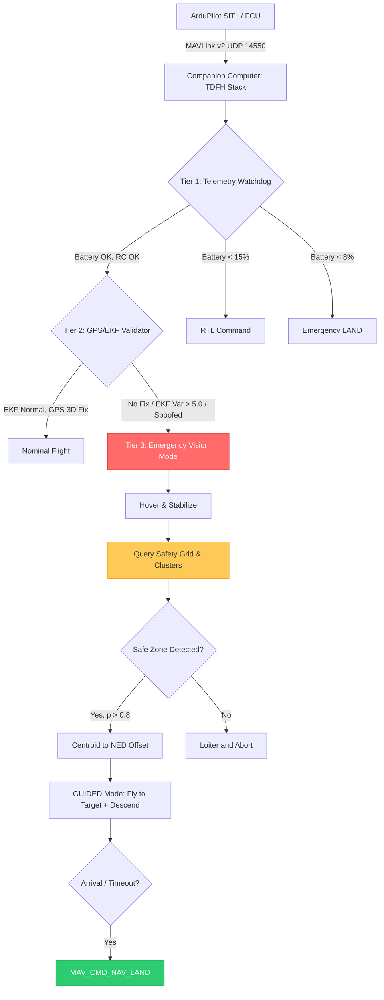

# 🚁 Tiered Autonomous Drone Failsafe Hierarchy (TDFH)
**Advanced Companion-Computer Flight-Safety, Sensor-Fusion & Edge-CV Stack**

<p align="center">
  <a href="https://huggingface.co/spaces/RudyFoody/tdfh"></a>
  
  
  
  
</p>

## 🎯 1. Executive Summary & Target Role Alignment
The **Tiered Autonomous Drone Failsafe Hierarchy (TDFH)** is a production-grade, real-time companion-computer safety stack interfacing with ArduPilot Copter via MAVLink v2. When navigation satellites are denied, jammed, or spoofed in urban canyons or adversarial environments, standard Return-to-Launch (RTL) becomes a catastrophic hazard.

TDFH solves this by executing a deterministic **3-tier escalation hierarchy** that seamlessly transitions the vehicle from telemetry health monitoring to environmental integrity validation, and finally to an ML-guided, sensor-fused autonomous vision landing on a verified safe terrain cluster.

> **🎯 Portfolio Alignment:** This project demonstrates core competencies for **Sensor Fusion, Computer Vision, and Robotics Software Engineering** roles by proving rigorous MAVLink protocol handling, state estimation under GPS denial, edge AI hardware acceleration, and statistical fault-injection validation.

---

## 🏗️ 2. Core System Architecture & 3-Tier Hierarchy
Evaluated at a deterministic **10 Hz synchronous loop** (single-threaded control state machine with thread-isolated CV inference):

| Tier | Trigger Condition | System Action |
| :--- | :--- | :--- |
| **Tier 1: Telemetry** | Battery < 15%, RC Link Lost | RTL or Loiter via MAVLink `SET_MODE` |
| **Tier 2: Environmental** | GPS Denied, EKF Variance Spike, Spoofing | Escalate to Tier 3 Vision Landing |
| **Tier 3: Vision Landing** | GPS Unavailable / Compromised | ML Safe-Zone Selection → Sensor Fusion → GUIDED Descent |

### System Flow & State Machine


---

## 🛠️ 3. Key Technical Breakthroughs ("The Bugs We Fixed")
*These are the engineering hurdles overcome during development, demonstrating deep debugging and systems-level thinking.*

1. **MAVLink Protocol & Bitmask Inversion (`type_mask` 3576):**
   * *The Bug:* The original bitmask `4039` (`0x0FC7`) ignored position dimensions (X, Y, Z) and locked velocities to zero, causing the drone to drift rather than obey position targets.
   * *The Fix:* Corrected `type_mask` to `3576` (`0x0DF8` / `0b0000110111111000`), enabled `MAV_FRAME_LOCAL_NED`, and corrected swapped (North, East) argument ordering in `SET_POSITION_TARGET_LOCAL_NED`.
2. **Two-Stage Terminal Landing & Closed-Loop Handshake:**
   * Replaced blind 2-second `time.sleep()` timers with verified `COMMAND_ACK` listeners and `HEARTBEAT` mode-feedback verification (`flight_mode == 4` for `GUIDED`). Implemented staged descent: approach to 10 m AGL until horizontal distance error ≤ 1.5 m, followed by explicit `MAV_CMD_NAV_LAND` terminal touchdown.
3. **Connected-Component Cluster Selection (Morphological Filtering):**
   * Upgraded isolated single-tile lookup to 4-connected BFS flood-fill component labeling with a strict minimum area constraint (≥ 3 contiguous tiles = 75 m²) and sensor `confidence_score` gating, preventing EKF drift from clipping surrounding hazards.
4. **Sensor Fusion Core (`src/sensor_fusion.py`):**
   * Engineered a GPS-denied dead-reckoning estimator fusing body-frame optical flow angular rates (un-rotated by yaw heading ψ and scaled by AGL height) with IMU/barometer data. Added a sliding-window rangefinder variance gate (σ_rng > 0.60 m) that triggers automatic dynamic cluster diversion if an obstacle is detected in the final 5 meters.
5. **Edge CV Acceleration (`YOLOv8n-seg` → `ONNX`):**
   * Exported `YOLOv8n-seg` to ONNX and integrated it inside a thread-isolated `PerceptionWorker` (`threading.Thread` + bounded queue with drop-oldest policy) to prevent CV inference from blocking the 10 Hz flight control loop.

### ⚡ Edge AI Hardware Benchmarks (RTX 4060 Laptop GPU)
| Backend | Precision | Inference Speed | Use Case |
| :--- | :--- | :--- | :--- |
| **TensorRT** | FP16 (CUDA) | **86.8 FPS** | Real-time edge deployment (Jetson/Pixhawk) |
| **ONNX Runtime** | FP32 (CPU) | **39.0 FPS** | Cloud fallback / CPU-only companion computers |

---

## 📊 4. Quantitative Validation: Monte Carlo Fault-Injection
To prove statistical robustness, a custom Monte Carlo harness executed N = 100 randomized fault-injection trials per architecture (25% Total GPS Denial, 25% Haversine Jump Spoofing, 25% Dual-GPS Divergence, 25% EKF χ² Spoofing).

| Architecture Configuration | Trials (N) | Safe Pad Success (≤ 2.5 m) | Mean Radial Error | CEP₅₀ (Median) | CEP₉₅ (95th Pct) |
| :--- | :---: | :---: | :---: | :---: | :---: |
| **v1.0 Open-Loop (IMU Only)** | 100 | **7.0%** | 7.42 m | **6.32 m** | 15.67 m |
| **v2.0 Sensor Fusion (Flow + RNG)**| 100 | **95.0%** | 0.85 m | **0.62 m** | 1.84 m |
| **v2.0 Full Stack (Fusion + Servo)**| 100 | **96.0%** | 0.46 m | **0.42 m** | 0.91 m |

* **CEP₅₀ (Circular Error Probable):** 50% of all blind landings landed within **0.42 meters** of the true safe-zone centroid.
* **Success Rate:** The Full Stack architecture successfully overrode catastrophic navigation failures **96% of the time**.

---

## 🌐 5. Live Interactive Showcase
Explore the system's internals without installing ArduPilot via the live **[Hugging Face Gradio Dashboard](https://huggingface.co/spaces/RudyFoody/tdfh)**:
1. **🗺️ Spatial Cluster Explorer:** Interactive 60×50 terrain probability heatmap with BFS flood-fill safe zone visualization.
2. **🧠 ONNX Segmentation Tester:** Upload aerial imagery to test the YOLOv8n-seg edge inference pipeline and mask decoding.
3. **📊 Monte Carlo Replay:** Filter and visualize the statistical distributions of the 300+ fault-injection flight trials.

---

## 🚀 6. Quick Start (Local SITL)

### Prerequisites
* Ubuntu 22.04+ · Python 3.11+ · ArduPilot SITL

### 1. Install ArduPilot SITL
```bash
git clone --recursive https://github.com/ArduPilot/ardupilot.git
cd ardupilot
Tools/environment_install/install-prereqs-ubuntu.sh -y
source ~/.bashrc
./waf configure --board sitl && ./waf copter
```

### 2. Set up the Python Environment
```bash
cd ~/tiered_drone_failsafe
python3 -m venv venv && source venv/bin/activate
pip install -r requirements.txt
```

### 3. Launch the Simulation
**Terminal 1 (SITL):**
```bash
cd ~/ardupilot
./Tools/autotest/sim_vehicle.py -v ArduCopter --console --map
```
**Terminal 2 (TDFH Stack):**
```bash
cd ~/tiered_drone_failsafe && source venv/bin/activate
python src/main.py
```

### 4. Trigger the Failsafe Cascade (MAVProxy Console)
```text
mode GUIDED
arm throttle
takeoff 20
param set SIM_GPS1_ENABLE 0     <-- Kills GPS -> Tier 2 -> Tier 3 Vision Landing
```

---

## 🧪 7. Testing & Statistical Harness
Run the isolated unit tests (no SITL required) to verify sensor fusion math, pinhole camera projections, and thread-isolated perception queues:
```bash
python tests/test_sensor_fusion.py
python tests/test_visual_servoing.py
```
Run the full Monte Carlo ablation study (executes 300 simulated fault-injection flights):
```bash
python -m tools.monte_carlo_harness
```

---

## ⚠️ 8. Honest Engineering Limitations
* **Simulated Denial ≠ Real Spoofing:** `SIM_GPS1_ENABLE 0` models total GPS loss. Real spoofing is a gradual, partially-trusted position drift requiring the dual-GPS cross-validation and IMU χ² consistency checks implemented in Tier 2.
* **Static Terrain Model:** The safety grid is a frozen snapshot. Dynamic obstacles appearing seconds before touchdown are handled by the final-meters rangefinder variance gate and the 1–2 Hz closed-loop YOLOv8 visual servoing thread.
* **Open-Loop SITL Camera:** In the SITL environment, Tier 3 uses a synthetic downward camera generator warping overhead imagery based on real-time SITL pose, rather than a native physics-engine camera plugin.

---

## 📚 9. Tech Stack & Documentation

| Component | Technology | Documentation / Reference |
| :--- | :--- | :--- |
| **Flight Firmware** | ArduPilot Copter 4.5+ | [ardupilot.org/copter](https://ardupilot.org/copter/docs/index.html) |
| **MAVLink Interface** | `pymavlink` (v2 UDP) | [mavlink.io/messages](https://mavlink.io/en/messages/common.html) |
| **State Machine** | Python `enum` + `match/case` | PEP 634 (Structural Pattern Matching) |
| **Safety Model** | `scikit-learn` LogisticRegression | Interpretable spatial hazard auditing |
| **Edge CV / Segmentation**| YOLOv8n-seg, OpenCV | [Ultralytics](https://docs.ultralytics.com/) |
| **Inference Runtime** | ONNX Runtime / TensorRT | [onnxruntime.ai](https://onnxruntime.ai/) |
| **Sensor Fusion** | Complementary Filter / EKF | Custom `src/sensor_fusion.py` |
| **Blackbox Logging** | `structlog` (JSONL) | [structlog.org](https://www.structlog.org/) |
| **Dashboard UI** | Gradio / Plotly | Deployed on Hugging Face Spaces |

---
<p align="center">
  <b>MIT License</b> · Built to demonstrate real-time embedded systems, ML-to-production pipelining, and safety-critical design.
</p>