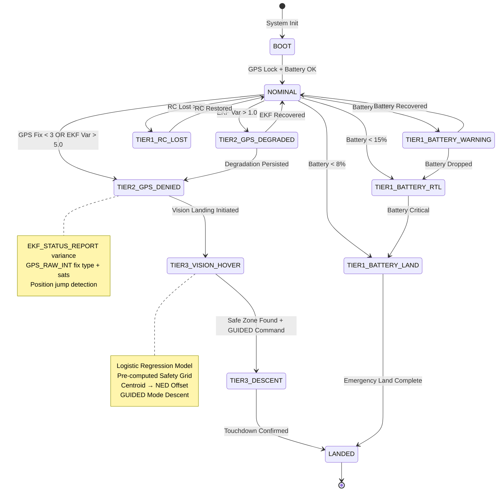
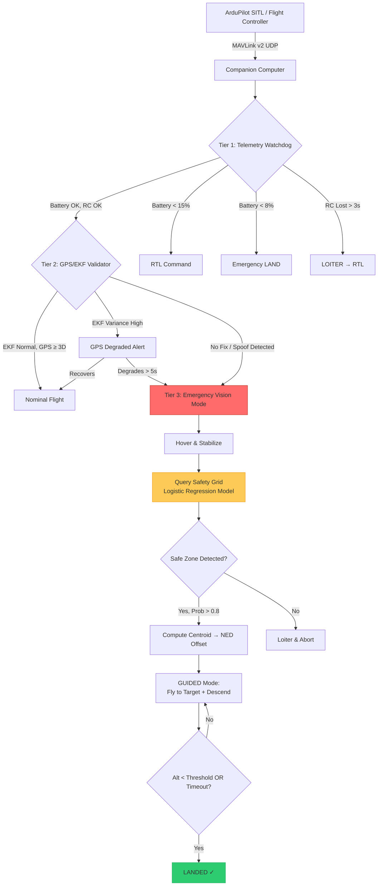

# System Architecture

## State Machine Flow



## System Overview



## Data Pipeline (From Notebook to Flight Stack)

```mermaid
flowchart LR
    A[Google Sheets CSV<br/>3000 Terrain Tiles] --> B[Feature Extraction<br/>8 terrain features]
    B --> C[Spatial Anchoring<br/>grid_x, grid_y]
    C --> D[Logistic Regression<br/>Pipeline + StandardScaler]
    D --> E[Safety Probability Grid<br/>60×50 heatmap]
    E --> F[Zone Tiering<br/>Preferred > 0.8<br/>Conditional 0.5–0.8<br/>Restricted < 0.5]
    F --> G[VisionLandingEngine<br/>find_safest_zone()]
    G --> H[Centroid → NED Offset<br/>→ GUIDED Descent]

    style D fill:#3498db,stroke:#2980b9
    style G fill:#e74c3c,stroke:#c0392b
```